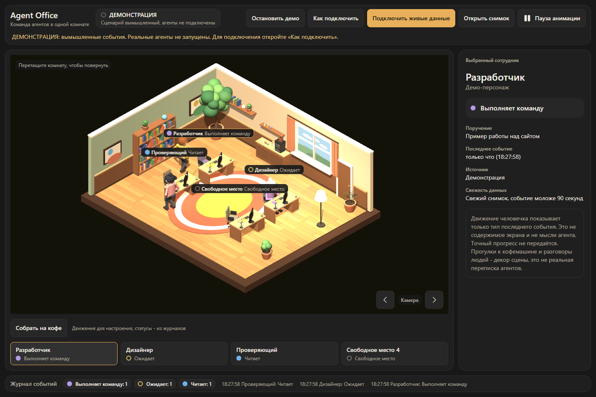

# Agent Office

A cozy, local 3D office for AI agents. No IvanOS folder, memory system, server, API key, or runtime pip dependencies required. The current interface is in Russian.

## Try it

Download the source ZIP, extract the whole folder, open `index.html` in desktop Chrome or Edge and click **«Посмотреть демо»** (View demo). The demo is explicitly labelled and uses simulated events.

## Connect your agents

On Windows 10/11 x64, download **Agent-Office-Windows-x64.zip** from [Releases](https://github.com/psimonov1993-blip/agent-office/releases/latest), extract it, and run **Agent Office.exe**. Python is included. The executable is unsigned; source-based execution is available if your device policy blocks it.

From source, install Python 3.10+ with Tkinter, then run `python office.py` (`python3` on macOS/Linux), or double-click `Start Office.cmd` on Windows. Linux may need `python3-tk`.

1. Run your agent and give it a task in its usual application.
2. Click **«Добавить Codex»** / **«Добавить Claude»** in the setup window. Select the session log and name your character. **«Другой агент (JSON)»** connects a custom status file.
3. Click **«Запустить офис»** (Start office), then **«Скопировать путь к файлу»** (Copy file path).
4. In the browser click **«Подключить живые данные»** (Connect live data) and select the copied `.runtime/agent-office.json` path.
5. Keep the setup window open. It updates every two seconds for up to two hours. Restart monitoring when needed. Closing it stops monitoring.

The application only monitors explicitly selected files. It does not launch agents or send them tasks. New sessions may need new log files. Internal Codex/Claude log formats are best-effort adapters, not stable public APIs. Custom JSON is the stable integration path described in [INTEGRATIONS.md](docs/INTEGRATIONS.md).

Configuration is saved locally in ignored `config.json`. Prompts, responses, commands, and tool arguments from logs are not copied into the browser snapshot. The observer physically reads bounded log tails to parse event types. Task labels are user-provided, not extracted from conversations.

There are up to six seats. Walking and coffee are decorative. Activity older than 90 seconds and snapshots older than 15 seconds are visibly marked as stale. The static-snapshot mode and reduced-motion setting stop animation.

Run tests with `python -m unittest discover -s tests`. See the [Russian README](README.md) for troubleshooting, CLI usage and development, and [BUILD.md](docs/BUILD.md) for packaging.

MIT license. Three.js is bundled under MIT with its notice in `vendor/THREE-LICENSE.txt`.
