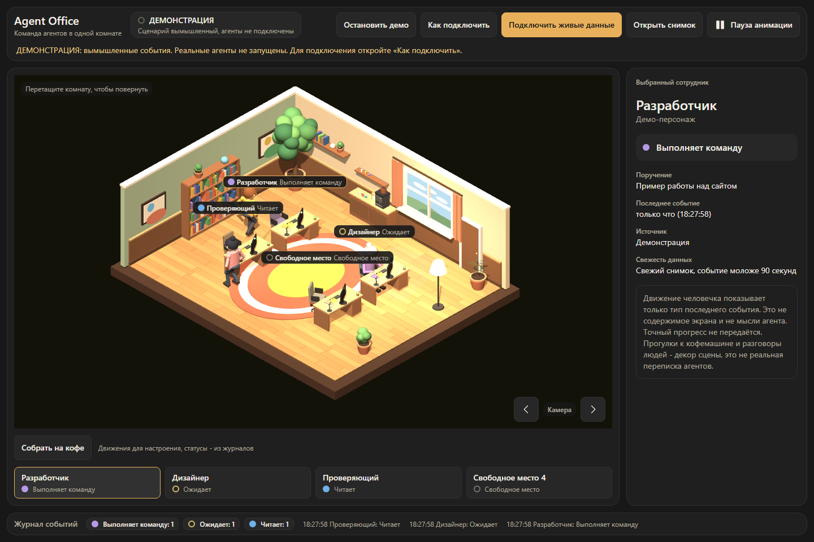

# Agent Office

**Уютный 3D-офис для ваших ИИ-агентов — локально, без IvanOS и системы постоянной памяти.**

Подключите журналы Codex и Claude или JSON состояния своего инструмента. Персонажи показывают последнюю распознанную активность: читают, правят файлы, выполняют команды. Свободные сотрудники могут сходить за кофе. До 6 мест, вращение камеры, пауза и режим уменьшенного движения.



Офис **наблюдает** за агентами. Задания им дают в их обычных приложениях. Движения персонажей — метафора; точный прогресс, переписка и экран агента здесь не показываются.

[Скачать готовую версию](https://github.com/psimonov1993-blip/agent-office/releases/latest) · [Интеграции](docs/INTEGRATIONS.md) · [English](README.en.md)

## Просто посмотреть — без установки

1. Нажмите **Code → Download ZIP** и полностью распакуйте архив.
2. Откройте `index.html` в настольном Chrome или Edge.
3. Нажмите **«Посмотреть демо»**.

Демо явно помечено: это вымышленные события, без подключения агентов. Python, аккаунт, API-ключи, сервер и интернет для демонстрации не нужны. Библиотека 3D уже лежит в `vendor`.

## Windows: живой офис без установки Python

1. В [Releases](https://github.com/psimonov1993-blip/agent-office/releases/latest) скачайте **Agent-Office-Windows-x64.zip**.
2. Полностью распакуйте архив в обычную папку, куда можно записывать файлы, например в «Документы». Не запускайте из ZIP.
3. Дважды нажмите **Agent Office.exe**. Нужен Windows 10/11 x64 и Chrome или Edge.
4. Запустите своего агента в привычном приложении и дайте ему задачу.
5. В мастере нажмите **«Добавить Codex»** или **«Добавить Claude»**, выберите журнал нужной сессии из списка и укажите имя персонажа. В списке показаны только имена файлов и время изменения.
6. Нажмите **«Запустить офис»**. Затем **«Скопировать путь к файлу»**.
7. В открывшемся браузере нажмите **«Подключить живые данные»**, вставьте путь в диалог выбора и откройте `agent-office.json`.

Оставьте мастер открытым. Файл обновляется каждые 2 секунды. Через 2 часа наблюдение остановится; запустите его снова той же кнопкой. Закрытие окна останавливает наблюдение. Автозагрузки и служб нет.

Приложение пока без цифровой подписи. Если политика вашего компьютера запрещает его запуск, используйте исходники и Python; отключать защиту не требуется.

## Запуск из исходников: Windows, macOS, Linux

Нужен **Python 3.10+ с Tkinter**. У приложения нет зависимостей из pip. Node.js, Docker и Git для запуска не нужны.

| Система | Как открыть мастер |
| --- | --- |
| Windows | Установите [Python](https://www.python.org/downloads/) с опцией **Add Python to PATH**, затем откройте `Start Office.cmd`. |
| macOS | Установите Python с python.org, откройте терминал в распакованной папке и выполните `python3 office.py`. |
| Linux | Установите Python и Tkinter (например, `sudo apt install python3 python3-tk` на Debian/Ubuntu), затем `python3 office.py`. |

Дальше выполните шаги 4–7 выше. На macOS вставляйте путь через **Cmd+Shift+G** в диалоге выбора. На Linux скрытая папка `.runtime` показывается через **Ctrl+H**. Скрипты `start.sh` и `Start Office.command` также доступны; после скачивания ZIP может понадобиться разрешение на исполнение.

Живое чтение требует браузерного `showOpenFilePicker`: используйте настольный Chrome или Edge. В других браузерах доступны демо и статический снимок при поддержке WebGL. [Описание механизма доступа к файлам](https://developer.chrome.com/docs/capabilities/web-apis/file-system-access).

## Что подключается

| Источник | Что выбрать | Ограничения |
| --- | --- | --- |
| Codex | `.jsonl` конкретной локальной сессии, обычно внутри `~/.codex/sessions` | Локальные форматы меняются между версиями. Видны только распознанные события выбранного журнала. |
| Claude Code, CLI или расширение | `.jsonl` сессии, обычно внутри `~/.claude/projects` | Для отдельной сессии нужен отдельный источник. |
| Другой агент | Ваш `.json` с `status` и `event_at` | Инструмент или ваш адаптер должен обновлять этот файл. Сам офис его не создаёт. |

Мастер учитывает `CODEX_HOME` и `CLAUDE_CONFIG_DIR`, если они заданы. Вручную можно выбрать файл из любой папки. Доступ к облачному чату без локального журнала не появляется автоматически.

Подпись задачи меняется через **«Изменить»**. Она не извлекается из переписки и не отправляется агенту. Новая сессия часто означает новый файл: остановите наблюдение и выберите её журнал. Поддержка помощников Codex ограничена распознанными событиями `collaboration` в выбранном журнале; при свободных местах они появляются автоматически. Это не список всех процессов компьютера.

## Где сохраняются данные

```text
ваша-папка/
  index.html          # 3D-офис
  guide.html          # инструкция, доступная без интернета
  office.py           # мастер подключения / консольный запуск
  monitor.py          # конфигурация и адаптеры
  observer.py         # чтение и фильтрация событий
  vendor/             # Three.js с лицензией
  config.json         # создаётся мастером: выбранные пути и подписи
  .runtime/
    agent-office.json # создаётся наблюдателем: безопасный снимок
```

`config.json` и `.runtime` исключены из Git. Их не нужно публиковать. Для переноса на другой компьютер скопируйте приложение и выберите журналы заново.

## Приватность и честность статусов

- Приложение не обращается к сети, не вызывает модели и не требует API-ключа. Расходы и подписки самих агентов зависят от выбранных инструментов.
- Наблюдатель читает ограниченный хвост **только выбранных файлов**. Тексты внутри этого хвоста физически попадают в память парсера, но промпты, ответы, команды, аргументы инструментов и учётные данные не копируются в снимок. Помощники получают нейтральные имена.
- Браузеру вы даёте чтение одного снимка, а не папки с перепиской. При новом открытии страницы выбор нужно повторить.
- «Завершено» означает событие завершения, а не проверку качества результата. Отсутствие свежей активности не означает, что процесс остановлен.
- Рабочее событие старше 90 секунд помечается устаревшим. Снимок без обновления 15 секунд тоже помечается устаревшим; рабочая анимация прекращается.
- «Собрать на кофе» влияет только на сцену. Пауза, статический снимок и системное уменьшение движения останавливают анимацию.

## Если не работает

| Проблема | Что сделать |
| --- | --- |
| Пустые столы | Откройте демо или подключите `.runtime/agent-office.json`. |
| Файл не найден | Сначала запустите наблюдение в мастере. Не выбирайте `config.json` или сырой `.jsonl` в браузере. |
| «Нет данных» | Проверьте выбранную сессию и сообщение мастера. В файле могут отсутствовать распознанные события. |
| «Снимок устарел» | Вернитесь в мастер и запустите наблюдение. Оно ограничено двумя часами. |
| Новая сессия не видна | Выберите новый журнал через мастер. Старый файл не переключается автоматически. |
| 3D не работает | Распакуйте весь архив, проверьте `vendor/three.min.js` и WebGL в браузере. Текстовые статусы работают и без 3D. |
| Нет окна настройки | Проверьте Tkinter: `python3 -m tkinter`. Возможен запуск без окна, описанный ниже. |

## Для разработчиков

Скопируйте `config.example.json` в `config.json` и замените примерные пути своими. Относительные пути считаются от файла конфигурации. `~/` означает домашнюю папку.

```sh
python office.py --headless --config config.json
python office.py --once --config config.json
python office.py --headless --duration 3600
python -m unittest discover -s tests
```

На macOS/Linux используйте `python3`, если команда `python` отсутствует. Выходной файл создаётся в `.runtime` рядом с конфигурацией. `--once` создаёт один снимок; для него в браузере используйте «Открыть снимок».

Браузерные проверки требуют отдельного инструмента разработки:

```sh
python -m pip install -r requirements-test.txt
python -m playwright install chromium
python tests/browser_checks.py
```

[Описание адаптеров и схемы](docs/INTEGRATIONS.md) · [Сборка Windows-архива](docs/BUILD.md) · [Правила вклада](CONTRIBUTING.md).

## Лицензия

MIT — можно использовать, менять и распространять с сохранением лицензии. Three.js r147 включён локально под MIT, см. [THIRD_PARTY_NOTICES.md](THIRD_PARTY_NOTICES.md).
